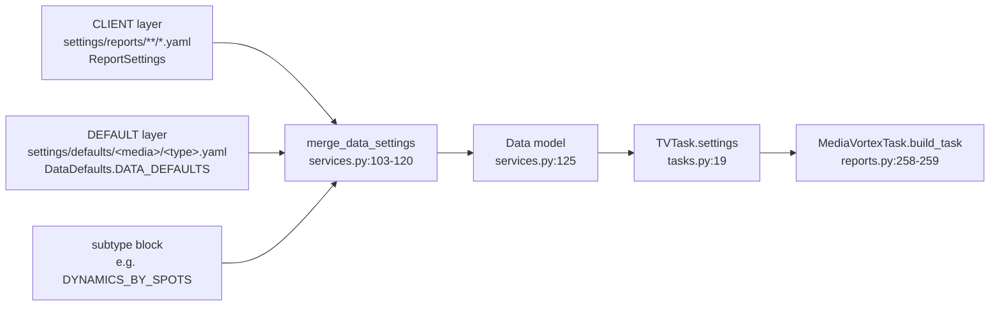
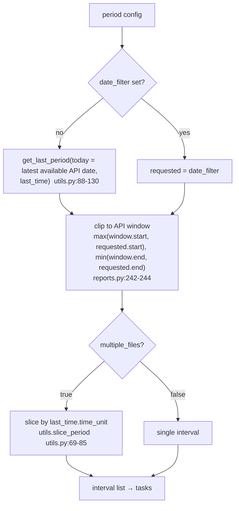
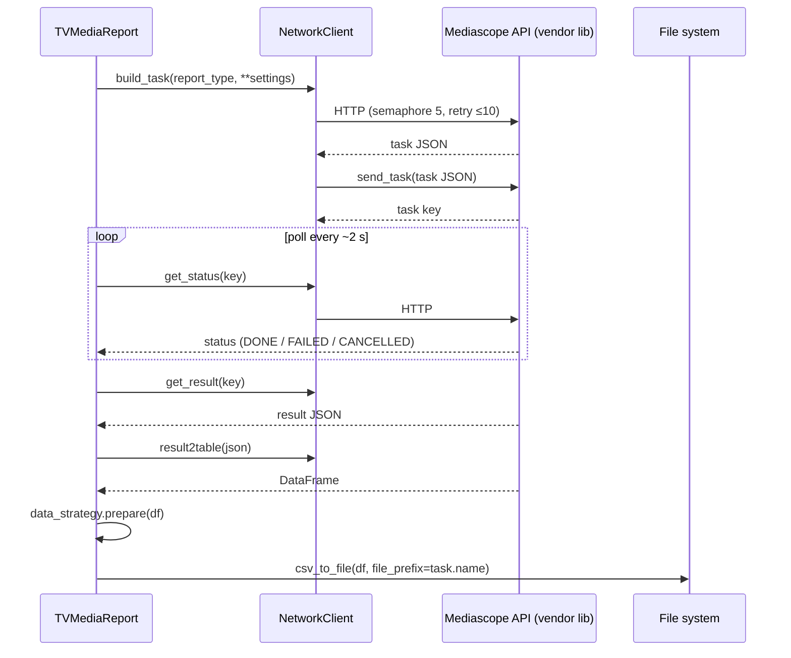

## Purpose

Single source of truth for **where data comes from, what happens to it, and
where it ends up** in `mko_get_mediascope_data`: the two-layer settings merge,
the period resolution rules, the task fan-out, the DataFrame preparation, and
the CSV writing rules. It complements
[Current Behavior](current-behavior.md) (the scenario view) and
[System Architecture](system-architecture.md) (the component view) by focusing
on the data itself. Each rule carries a certainty label; rules whose business
meaning is unconfirmed are marked `[open]` and tracked in
[Open Questions](open-questions.md).

## Main Concepts

### Data sources and formats

| Source | Format | Where it enters | Certainty |
|---|---|---|---|
| User report definition | YAML list of report entries | `run <file>` / `run_report(path)` → `ReportSettings` (`services.py:84-91`, `models.py:83-106`) | `[code]` |
| DEFAULT parameter template | YAML with `DATA_DEFAULTS` + subtype blocks | `settings/defaults/<media>/<report_type>.yaml` → `DataDefaults` (`services.py:93-101`, `models.py:119-121`) | `[code]` |
| App/log configuration | YAML | `settings/app_config.yaml`, `settings/log_config.yaml` (`services.py:37-55`) | `[code]` |
| Mediascope credentials | JSON | `settings/connections/mediascope.json` (`paths.py:58-59`) | `[code]` |
| Mediascope API | HTTP JSON | vendor library `mediascope-api-lib` (`MediaVortexTask`), called through `NetworkClient` (`services.py:7`, `network.py:59`) | `[code]` |
| Previously written outputs | CSV/CSV.gz files | read as a name set (not parsed) for resume logic (`reports.py:75-80`) | `[code]` |

### The merge: two layers into one API parameter set

Merge rules, in order `[code]`:

1. Start from a shallow copy of `DATA_DEFAULTS` (the full Mediascope parameter
   set: `date_filter`, `weekday_filter`, `daytype_filter`, `company_filter`,
   `location_filter`, `basedemo_filter`, `targetdemo_filter`, `program_filter`,
   `break_filter`, `ad_filter`, `slices`, `statistics`, `sortings`, `options`,
   `frequency_dist_conditions`) (`services.py:107`).
2. If `report_subtype` names a block that exists as an attribute on the loaded
   defaults, overlay that block with `dict.update` — whole-value replacement per
   top-level key (`services.py:109-111`).
3. Overlay the report's own keys, but **only keys that already exist** in the
   merged dict (`services.py:113-115`). In practice the intersection of
   `ReportSettings` fields with `DATA_DEFAULTS` is `ad_filter` plus any API
   parameter keys the report defines as extras (for example `slices`,
   `statistics`, `options`, `company_filter` in
   [`nat_tv_tvreport.yaml`](../../src/mko_get_mediascope_data/settings/reports/nat_tv_tvreport.yaml)).
   Report-only fields (`media`, `period`, `relative_path`, …) never leak into
   the API parameters.
4. If `data_lang == "ru"`, replace the `EName` suffix of every slice with
   `Name` (`services.py:117-118`, `utils.en_to_ru`, `utils.py:203-211`) — e.g.
   `advertiserListEName` → `advertiserListName`.

The merge is intentionally a **shallow top-level overlay**, not a deep merge —
this is an owner decision about the settings architecture (D-01, given during
the template-conformance review; pointer: the re-validation note in the audit
corpus). Consequence for template authors: a report that overrides a
block-level key (`options`, `slices`, …) must supply the complete block, because
partial sub-keys are not merged.

### Period resolution

Rules and their edge cases `[code]`:

- The reference "today" for `last_time` is the **latest date the API reports as
  available**, not the system clock (`reports.py:231-238`).
- `last_time` semantics (`utils.get_last_period`): start = N whole units back
  from the start of the current unit; `include_current: false` additionally
  moves the end back to just before the current unit (for weeks, end = start +
  N−1 weeks + 6 days).
- The API window comes from `cats.get_availability_period()` filtered by
  `options.kitId` (`reports.py:193-205`; `base_id` default 1, `reports.py:189`).
  What each `kitId` value means is **not** asserted anywhere: the owner has
  declared the in-template legend stale and will supply the current mapping
  when available (D-20, DISC-11).
- **Clipping can invert the period** (start > end) when the requested range does
  not overlap the window, silently (`reports.py:242-244`); executed in a probe: zero intervals for a non-overlapping request (lead: audit PIPE-005).
- **The interval length always comes from `last_time.time_unit`**, even when
  `date_filter` is used, and the code reads it unconditionally — a report with
  `date_filter` and `last_time: null` crashes (`reports.py:241`); executed in a probe (lead: audit PIPE-003). The file names therefore do not necessarily match the folder names:
  the on-disk exports show weekly files inside `…/channels_tva_m/`
  (`[code — folder name from relative_path, interval from time_unit]`,
  cross-checked against the machine's historical outputs).

### Task fan-out

| Strategy | Produces | Task/file name |
|---|---|---|
| `DefaultTVTaskStrategy` (`reports.py:358-381`) | interval × audience tasks | `<start>_<end>_<ascii audience name>` |
| `TVRegTaskStrategy` (`reports.py:384-432`) | region × interval × audience tasks | `<start>_<end>_<ascii audience>_<ascii region name>`; region id 99 is currently hard-coded as excluded (only 99 — the owner recalled 99 and 100, DISC-09; template-driven selection is the intent, D-10); company filter extended with `regionId IN (<id>)` |

Audience names are transliterated with `unidecode` (`reports.py:375`,
`:413-421`), which is why on-disk file names contain plain ASCII audience labels
such as `all 20-45 BC`. The current exclusion of region id 99 is a code-level
rule the owner has declared incorrect; the meaning of region ids is not
documented in the repository — see Q-05 / D-10.

### Per-task data path inside the API cycle

Every vendor call goes through `NetworkClient.call`, which serializes blocking
vendor calls into worker threads under an `asyncio.Semaphore(5)` and retries
transient errors (`network.py:59-126`; full contract in
[async-concurrency-architecture.md](async-concurrency-architecture.md)). One
call bypasses it: `TVRegTaskStrategy` calls `catalogs.get_tv_region()`
directly (`reports.py:387`), so that catalog read gets no retry, no semaphore,
and no thread offloading `[code]`.

### DataFrame preparation rules

**Default strategy** (`reports.py:435-454`) `[code]`:

1. rename `prj_name` → `targetAudience` if present;
2. keep exactly the configured columns: slices (with `targetAudience` inserted
   first when `target_audiences` is set, and `frequencyDistInterval` appended
   when frequency distribution is configured) then statistics
   (`reports.py:207-221`);
3. if `frequencyDistInterval` is among the columns, split the base row
   (`frequencyDistInterval == "-"`) from the frequency rows and pivot the
   frequencies into columns (`utils.pivot_df_frequency`, `utils.py:214-252`);
4. any missing column raises `KeyError`, which is logged (column name, without
   the task name) and turned into `None` → the task is marked failed and an
   error YAML is written (`reports.py:452-454`; lead: audit PIPE-008).

**Dictionary strategy** (`reports.py:457-509`, selected when the subtype name
contains `DICT`, `reports.py:42-47`) `[code]`:

1. check the configured slice columns exist; if any is missing, log and return
   `None`;
2. melt the frame to `(column, value)` pairs, drop nulls and duplicates;
3. build the fixed output layout `action, search_column_idx, value, term, cat,
   adv, bra, sbr, mdl, cln_0 … cln_5`, where `action` is the constant `upd`,
   `term` is the quoted value, and the slice columns fill `cat`…`mdl` and
   `cln_*` positionally.

The business meaning of this dictionary layout (which downstream system consumes
it, and what `cat`/`adv`/`bra`/`sbr`/`mdl` stand for beyond the obvious
category/advertiser/brand/subbrand/model reading) is not documented in the
repository — `[open]` Q-09.

### Output writing rules

`utils.csv_to_file` (`utils.py:167-200`) `[code]`:

- path = `<csv_path_out>/<file_prefix><optional timestamp><ext>`, where `ext`
  follows the `compression` setting (`.csv`, `.csv.gz`, `.csv.bz2`, …;
  `utils.get_files_suffix`, `utils.py:133-164`);
- `to_csv` with `sep=";"`, `decimal=","`, `index=False`, `encoding="utf-8-sig"`,
  `compression=<setting>`, `mode="x"`;
- `lineterminator` is not set, so line endings follow the platform
  (`utils.py:186-198`; lead: audit OUT-002);
- if the file exists, `FileExistsError` is swallowed: a warning is logged and
  the function returns `None` — the caller cannot tell "written" from
  "skipped" (probe-verified; lead: audit PIPE-001 / OUT-003).

### Handling of missing, duplicate, and unexpected values

| Case | Handling | Certainty |
|---|---|---|
| Output file already exists (duplicate) | Pre-filtered before submission by `check_done`: existing file names (extension stripped) are collected and matching tasks are skipped (`reports.py:70-80`, `:378-380`); the TV_REG strategy skips silently (`reports.py:430-431`; lead: audit PIPE-011) | `[code]` |
| Empty result DataFrame | Task marked failed, no CSV, error YAML written (`reports.py:316-318`); `log_error` is written in five places and read nowhere (grep-verified), so "empty" vs "error" has no observable effect. Per the owner, missing/empty data should produce a **warning, not an error file** (D-08, D-15) — gap G-01 | `[code]` |
| Result JSON not returned | Task marked failed, error YAML (`reports.py:304-307`) | `[code]` |
| Missing columns in the DataFrame | `KeyError` → log → task failed (`reports.py:452-454`) | `[code]` |
| Unknown `report_subtype` (no matching defaults block) | No overlay happens, so the base `DATA_DEFAULTS` Nulls survive. With `data_lang: ru` (the default) the merge crashes in `en_to_ru(None)` with `TypeError` (probe-verified). With `data_lang: en` the merge completes and the run instead fails at `Data(**merged)` with a Pydantic `ValidationError` (probe-verified), because `slices`/`statistics`/`sortings`/`options` are non-optional `dict | list` fields (`models.py:124-128`) | `[code]` |
| Unknown keys in a report YAML (e.g. legacy `folder`, `category_name`) | Absorbed as Pydantic extras, then dropped by the merge unless the key exists in `DATA_DEFAULTS`; no error, no warning (verified: both legacy keys have zero references in `core/`) | `[code]` |
| Missing DEFAULT template for the `(media, report_type)` pair | `FileNotFoundError` from `yaml_to_dict`, run aborts (`services.py:96-101`; verified: files absent; lead: audit TPL-005) | `[code]` |
| Vendor rejects a request (HTTP 4xx / auth) | Raised immediately by `NetworkClient`, aborting the run (`network.py:76-93`) | `[code]` |

### Provenance and preservation of original values

- The exported CSV contains only the columns the report selects, renamed
  (`prj_name` → `targetAudience`) or localized (`*EName` → `*Name`); no
  values are recomputed by this tool `[code]`.
- The original request that produced each file is preserved in
  `TVTask.settings` and written to the error YAML when a task fails
  (`tasks.py:29`). For successful tasks the settings are **not** persisted — the
  output file name encodes only interval and audience `[code]`. The owner
  confirmed this is intended: only failures are persisted (D-18).
- Decimal values are written with a comma decimal separator and a BOM
  `[code]`; the owner confirmed these conventions are correct for now and are
  to become configurable later — defaults in `settings/app_config.yaml` with
  per-report overrides (D-13).

## Related Docs

- [Doc Maintenance Rules](doc-maintenance-rules.md)
- [Current Behavior](current-behavior.md)
- [System Architecture](system-architecture.md)
- [Product Overview](product-overview.md)
- [Open Questions](open-questions.md)
- [Settings Layers Architecture](settings-layers-architecture.md)
- [Async Concurrency Architecture](async-concurrency-architecture.md)
