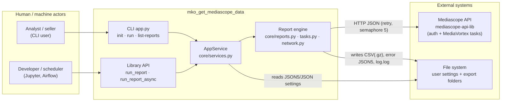
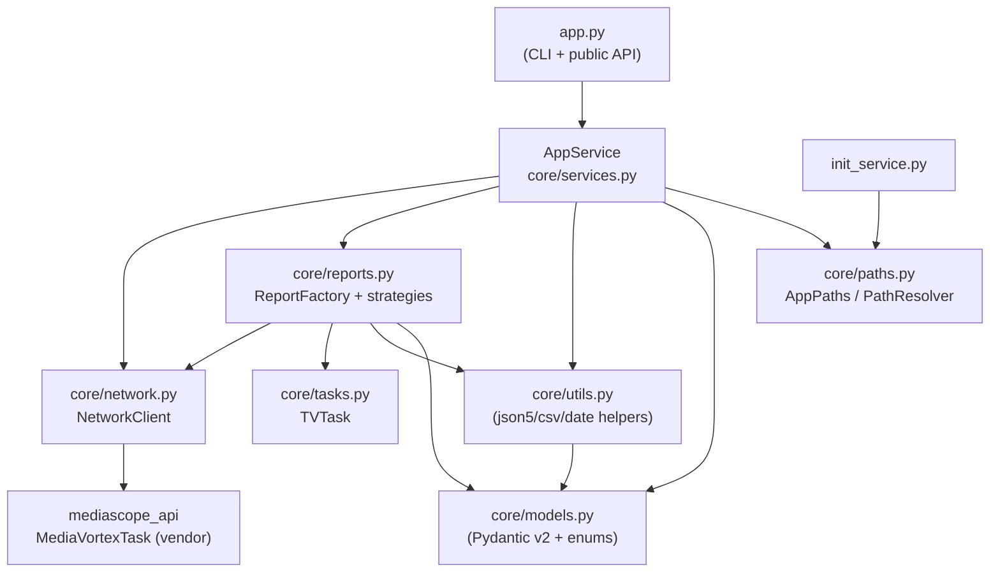
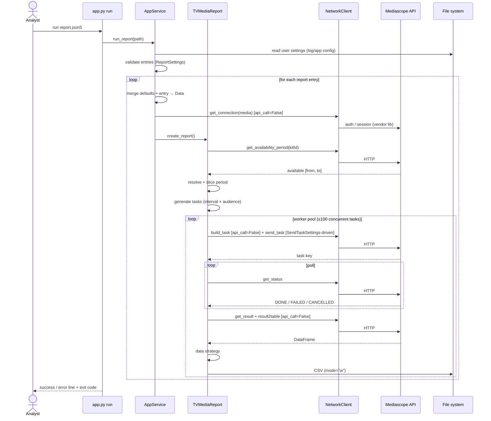

## Purpose

Technical architecture of `mko_get_mediascope_data`: the system context, the
major components and their responsibilities, the direction of calls, the public
interfaces, the execution flow of the key scenario, and the significant risks
and trade-offs. Deep dives on the two cross-cutting mechanisms live in their own
documents and are not repeated here:
[settings-layers-architecture.md](settings-layers-architecture.md) and
[async-concurrency-architecture.md](async-concurrency-architecture.md).

## Main Concepts

### System context

There is no database, no web server, and no message broker; the only external
dependency is the Mediascope HTTP API, reached through the vendor library
`mediascope-api-lib` (`pyproject.toml` dependencies; `services.py:7`).

### Components and responsibilities

| Component | File | Responsibility | Public? |
|---|---|---|---|
| CLI app | `app.py` | Typer commands (`init`, `run`, `list-reports`), Rich console output, sync/async public wrappers | yes — module-level functions |
| Package root | `__init__.py` | Lazy re-export of the public API via PEP 562 `__getattr__` so importing the package does not bootstrap the service | yes |
| Path resolution | `core/paths.py` | `AppPaths` (where settings, defaults, reports, credentials live) and `PathResolver` (relative → absolute under the user folder) | no |
| Settings bootstrap | `core/init_service.py` | Copy bundled templates into the user settings folder | no |
| Models | `core/models.py` | Pydantic v2 schema for settings (`ReportSettings`, `PeriodModel`, `LastTimeModel`, `DataDefaults`, `Data`, …) and the fixed-value enums | no |
| Orchestrator | `core/services.py` | `AppService`: config loading and caching, settings merge, connection creation, per-report loop; process-wide lazy singleton | no (`get_app_service` is the internal accessor) |
| Report engine | `core/reports.py` | `ReportFactory` + strategies; `TVMediaReport` lifecycle: period resolution, task generation, submit/poll/extract, worker pool | no |
| Task model | `core/tasks.py` | `TVTask`: name, settings, status, error; error-JSON5 serialization | no |
| Network layer | `core/network.py` | `NetworkClient.call`: semaphore-bounded, thread-offloaded, retrying wrapper around most vendor calls; the `api_call=False` discriminator short-circuits CPU/local calls (`builder`, `result2table`, `get_connection`) to direct `_invoke` (bypassing jitter, semaphore, and retry); the direct `cats.get_tv_region()` catalog read in `TVRegTaskStrategy` bypasses `NetworkClient` entirely | no |
| Utilities | `core/utils.py` | Date/period math, JSON5/CSV I/O, suffix mapping, slice localization, frequency pivot, file listing | no |
| Errors | `core/errors.py` | `NoReportFoundError`, `WrongDataSettings` — `NoReportFoundError` is raised by `get_period` for out-of-range periods (`reports.py:327-330`) and by `processing_tasks` for zero enqueued tasks (`reports.py:213-218`); `WrongDataSettings` is declared but unused (reserved for future subtype-default validation) | no |

### Component diagram (call direction)

Verified call directions (not inferred from names) `[code]`:

- `app.run` → `get_app_service().run_report` (`app.py:57`, `services.py:166`).
- `AppService.run_report` → `get_report_settings` → `ReportSettings`
  (`services.py:85-98`); → `get_data_settings` → `get_default_data_settings` +
  `merge_data_settings` → `Data` (`services.py:135-138`); → `NetworkClient.call(
  self.get_connection, media, api_call=False)` (`services.py:186-190`); → `ReportFactory(...)` →
  `TVMediaReport(...)` → `create_report()` (`services.py:194`).
- `TVMediaReport.create_report` → `get_period()` → `get_available_period()` →
  `network_client.call(catalogs.get_availability_period)` (`reports.py:236-295`,
  `:283-289`); → `processing_tasks()` → `generate_tasks()` →
   `task_strategy.generate(self)` (`reports.py:202-219`, `:512-514`).
- `worker` → `send_task` → `network_client.call(builder, api_call=False)` then
  `network_client.call(sender, ...)` (config-driven via `SendTaskSettings`); → `wait_task` → `network_client.call(
  get_status)`; → `extract_data` → `network_client.call(get_result)` and
  `network_client.call(result2table, api_call=False)` → `prepare_data` → `data_strategy.prepare`
  → `asyncio.to_thread(utils.csv_to_file, …)` (`reports.py:162-239`, `:440-614`).

### Data-flow overview

The per-task transformation detail is documented in
[data-flow-architecture.md](data-flow-architecture.md).

### Execution flow of the key scenario (run)

Error path worth understanding, with the failure classes separated `[code]`:

- **Before the worker pool** (`create_report` → `get_period` →
  `get_available_period`): a failure aborts the run with a printed error and
  exit code 1 — visible and loud (`reports.py:220-223`).
- **Logical failures inside the pool** (no task key, empty result, missing
  columns): `task.status = False`, error JSON5 written, warning logged, run
  continues — the designed recovery path.
- **Exceptions raised inside a worker** (`BadRequestError`, `AuthorizationError`,
  `RuntimeError` after retry exhaustion): since W-02 the worker wraps
  `_process_item` in `try/except/finally` (including `asyncio.wait_for` when a
  `timeout` is set), so exceptions are caught, the task is marked failed, an
  error JSON5 is written via `json5.dump`, and `task_done()` is always called
  in `finally` — no hang, no silent worker death
   (`reports.py:149-188`). The pre-W-02 behavior (hang on `queue.join()`) was
  resolved by W-02; see the precision note in
  [Open Questions](open-questions.md#precision-note-on-g-02-which-failures-hang-and-the-owners-observation).

### Configuration and external dependencies

| Dependency | Role | Notes |
|---|---|---|
| `mediascope-api-lib` | Vendor API client: authentication, task build/send/status/result, catalogs | Instantiated per report as `MediaVortexTask(settings_filename=…/mediascope.json, check_version=False)` (`services.py:140-154`) |
| `pandas` | Result table conversion and CSV writing | `result2table` returns a DataFrame; `csv_to_file` writes it |
| `pydantic` v2 | All settings models and validation | see [settings-layers-architecture.md](settings-layers-architecture.md) |
| `typer` + `rich` | CLI and console output | `app.py` |
| `platformdirs` | User settings folder location | `paths.py:4` (import), `:9` (`USER_DIR`) |
| `json5` | Template/config parsing | `utils.json5_to_dict` |
| `Unidecode` | ASCII-safe file names for audiences and regions | `reports.py:375`, `:413-421` |
| `python-dateutil` | Calendar arithmetic for periods | `utils.get_last_period`, `iter_period_slices` |

Runtime knobs that shape behavior, all hard-coded defaults (no config file
maps to them): `max_tasks = 100` (`reports.py:113`), `NetworkClient`
(`max_concurrent_requests=5`, configurable via `app_config.json5`, `sleep_time=2`, `max_attempts=10`,
`call_timeout=300.0`, `retry_5xx=True`, `log_errors_detail=False`,
`network.py:101-110`), `api_call=False` discriminator on `builder`/`result2table`/
`get_connection` short-circuits `NetworkClient.call` to direct `_invoke`
(network.py:174-175), task-submission POST is config-driven via `SendTaskSettings`
(reports.py:465-467), poll cadence starts at 30 s and ramps to 60 s (increasing:
30 → 50 → 60) (`reports.py:517, 557`), with `get_status(sleep_time=30)`
(`reports.py:533-535`). **No row-count limit
is enforced** — `resultBody` of any size is always passed through to
`result2table`/`DataFrame` materialization (`max_result_rows` was removed in
W-13). Per-task latency is
logged via structured `task_stage_complete`/`task_complete` records
(`reports.py:177-183, 469-475, 560-566, 615-621`) replacing the prior
`logger.info("=")` placeholder in `send_task`.

### Design decisions and trade-offs

| Decision | Rationale (as recorded) | Trade-off |
|---|---|---|
| Two-layer settings with shallow overlay | Owner decision (D-01); templates stay small and vendor parameters live in one place | A typo in a report JSON5 that is not a `DATA_DEFAULTS` key is silently dropped by the merge; a typo inside a DEFAULT/subtype block reaches the vendor `build_task`, which has no `**kwargs`, and raises `TypeError` (verified against the installed library) |
| Two-level concurrency (`max_tasks=100` vs HTTP semaphore 5) | Documented as intentional independence in [async-concurrency-architecture.md](async-concurrency-architecture.md) | More knobs to reason about; the worker pool can pin 100 vendor tasks while only 5 HTTP calls fly |
| Resume via existing file names (`check_done`) | Cheap idempotent re-runs without a state store | The name is the only identity key — rename a file and the task re-runs; the skip is   silent in the TV_REG path (`reports.py:539`) |
| `mode="w"` (overwrite) | Re-runs overwrite transparently; the `check_done` pre-filter is what prevents re-submission of already-written tasks | A `mode="x"` design would swallow `FileExistsError` and make skipped writes indistinguishable from success — since W-02, `mode="w"` is used and `FileExistsError` is never raised |
| Errors as side-car JSON5 files | Keeps the export folder the single place to look | Written with `json5.dump`, producing plain JSON5 that round-trips with `json5.load` (`tasks.py:7, 52-57`); since W-02 the worker catches exceptions and always reaches the error-JSON5 path |
| `extra="allow"` on settings models | Intended pass-through of template-defined API parameters | No validation of unknown keys; legacy keys (`folder`, `category_name`) are silently ignored (zero references in `core/`) |
| Lazy singleton `get_app_service()` | Importing the library must not touch the file system (commit `706eed0`; covered by `tests/test_app.py::test_package_import_does_not_bootstrap`, run: passed) | First use pays config loading; a missing user config surfaces at first command, not at import |

### Risks and known technical limitations

Every row below was verified against the code by this investigation. The audit
corpus is a lead source only (owner ruling D-05): the IDs in the last column
are pointers, not evidence, and several audit entries do not match HEAD.

| Risk / limitation (code-verified) | Code evidence | Also recorded as |
|---|---|---|
| **RESOLVED (W-01):** No shipped report template could run end-to-end (30/32 entries failed validation; both crosstab defaults were malformed [pre-JSON5 migration]) | probe + `test_models.py::test_bundled_templates_validate` | audit TPL-001 / TPL-004 leads; gap G-05 → CLOSED |
| **RESOLVED (W-02):** A single network raise could hang the whole run (no worker exception isolation) | `reports.py:149-188` (try/except/finally with `task_done()` in `finally`) | audit PIPE-002 / ASY-001 leads |
| **RESOLVED (W-02):** Zero-task and out-of-window periods exited 0 silently | `reports.py:327-330` (NoReportFoundError for out-of-range), `:213-218` (NoReportFoundError for zero tasks) | audit PIPE-004 / PIPE-005 leads |
| **RESOLVED (W-02):** Poll loop had no deadline | `reports.py:363` (`max_polls=60`, `poll_deadline=3600.0` params), `reports.py:373-386` (guard checks) | audit PIPE-006 lead |
| **RESOLVED:** Type safety unenforced: mypy red, no CI | `pyproject.toml:137` (`mypy` files = src + tests); `.github/workflows/ci.yml` runs `ruff check src tests` + `pytest`; `uv run mypy src tests` → **0 errors** (verified 22 source files) | audit OPS-001 lead |
| Named loggers in `log_config.json5` never fire; root handler applies | `services.py:58-65` vs module logger names | audit OPS-003 lead |
| Test suite covers utils/models/strategy selection only; no coverage of the period, worker, and CLI happy paths | `tests/` (42 collected, 42 pass, verified `test_create_report_skips_done_files` + `test_create_report_timeout_does_not_hang`) | audit TST-* leads |
| **RESOLVED (W-02):** `errors.py` exceptions were dead code | `errors.py:1-9`; `NoReportFoundError` now raised at `reports.py:327-330` and `:213-218` | — |
| One `requests.Session` per report entry, never closed | `services.py:140-154`; vendor `mediavortex/tasks.py:43-47`, `core/net.py:73` | audit EXT-006 lead |
| Live API behavior never observed in this investigation (no credentials) | stated limitation of this investigation | — |

### Gaps between owner intent and this architecture

Recorded from the owner's 2026-10-15 answers; the full register with decision
IDs is in
[Open Questions](open-questions.md#gaps-between-owner-intent-and-current-implementation).
G-01 and G-02 have been **resolved by W-02**; G-03–G-05 remain open pending
their respective work items. These are pending work items, not defects
introduced by this documentation:

- **G-01** — RESOLVED by W-02. Silent empty runs are no longer silent:
  out-of-range periods raise `NoReportFoundError`, zero-task runs raise
  `NoReportFoundError`, and partial overlap emits a `logger.warning()`
  (intent: warn, never interrupt, D-08).
- **G-02** — RESOLVED by W-02. Worker exceptions are caught in
  `try/except/finally`, an error JSON5 is written via `json5.dump`, and
  `task_done()` is always called in `finally` (intent: never stop the export;
  always persist a failed task's description, D-09/D-17).
- **G-03** — region selection is hard-coded (id 99) instead of template-driven
  (intent: user template expresses inclusion/exclusion; research R-01, D-10).
- **G-04** — output conventions (separators, BOM, DICT columns) are hard-coded
  (intent: configurable defaults + per-report overrides, D-13/D-14).
- **G-05** — **RESOLVED by W-01.** All 32 bundled report entries now pass
  `ReportSettings` validation; all 6 DEFAULT templates ship; both crosstab
  defaults parse correctly (intent: keep everything runnable, D-06).

## Related Docs

- [Doc Maintenance Rules](doc-maintenance-rules.md)
- [Current Behavior](current-behavior.md)
- [Data Flow Architecture](data-flow-architecture.md)
- [Product Overview](product-overview.md)
- [Open Questions](open-questions.md)
- [Settings Layers Architecture](settings-layers-architecture.md)
- [Async Concurrency Architecture](async-concurrency-architecture.md)
